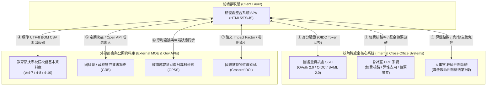

# 輔英科技大學 研發處服務整合系統 — 跨處室系統介接技術規格書

> **文件版本**：v2.4  
> **制定單位**：研究與產學發展處 (處本部 / 產學合作組 / 研發創新組)  
> **會辦單位**：圖書暨資訊處 (資訊系統組)、會計室 (第一組/第二組)、人事室 (考訓福利組)  
> **主管依據**：
> - 輔英科技大學學術單位組織編制 (4 院 16 系所)
> - 人事室《專任教師評鑑辦法》第七條 (行政主管免評規定)
> - 會計室《執行計畫彈性支用額度作業要點》及支出憑證核銷規範
> - 教育部全國技專校院校務基本資料庫 (雲科大維運平臺) 填報作業規範

---

## 系統介接拓撲架構圖



---

## 第一單元：圖書暨資訊處 SSO 單一簽入介接規格 (Library & Info Center SSO)

### 1.1 協定與端點規格
系統採用標準 **OpenID Connect (OIDC)** 授權碼模式 (Authorization Code Flow with PKCE) 及相容 **SAML 2.0** Web Browser SSO Profile。

- **IdP 發行者 URL (Issuer)**: `https://inf.fy.edu.tw/sso/v2`
- **授權端點 (Authorization Endpoint)**: `https://inf.fy.edu.tw/sso/v2/authorize`
- **權杖端點 (Token Endpoint)**: `https://inf.fy.edu.tw/sso/v2/token`
- **使用者資訊端點 (UserInfo Endpoint)**: `https://inf.fy.edu.tw/sso/v2/userinfo`
- **公鑰輪替端點 (JWKS URI)**: `https://inf.fy.edu.tw/sso/v2/.well-known/jwks.json`
- **單一登出端點 (SLO Endpoint)**: `https://inf.fy.edu.tw/sso/v2/logout`

### 1.2 JWT ID Token 聲明欄位 (Claims)
```json
{
  "iss": "https://inf.fy.edu.tw/sso/v2",
  "sub": "ZH177",
  "aud": "fy-rd-integrated-system",
  "exp": 1792036800,
  "iat": 1792000800,
  "empId": "ZH177",
  "name": "賴文亮",
  "email": "wllai@fy.edu.tw",
  "college": "環境與生命學院",
  "dept": "環境工程與科學系",
  "title": "特聘教授",
  "adminRole": "教授兼研發長",
  "isArticle7Exempt": true,
  "roles": ["DEAN", "RESEARCHER"],
  "authorizedGroups": ["研發創新組", "產學合作組", "處本部"]
}
```

### 1.3 角色權限對應矩陣 (RBAC)
| 角色代碼 | 代表身分 | 權限範圍 |
| :--- | :--- | :--- |
| `DEAN` | 賴文亮 研發長 | 全校 4 院 16 系所總覽、全校性推薦名單、跨處室聯名決策、獎勵金審定 |
| `HQ_STAFF` | 研發處 處本部人員 | 私校獎補助支用統籌、教育部校務資料庫 (TVEDB) 彙整、6年6個月產業研習管理 |
| `IAC_STAFF` | 研發處 產學合作組人員 | 企業產學與部會委辦計畫管考、技轉合約管理、70% 權利金試算、會計傳票核發 |
| `RDI_STAFF` | 研發創新組人員 | 國科會專案申請、SCI/SSCI 期刊獎勵審查、專利補助審議、先期產學社群管考 |
| `TEACHER` | 學院系所專任教師 | 個人成果預填確認單送交、各項獎勵申請線上送件、個人評鑑點數進度即時試算 |

---

## 第二單元：會計室經費動支與傳票核銷介接規格 (Accounting Office ERP)

### 2.1 介接目標
1. 即時驗證研究計畫之會計代碼 (`accCode`)、核銷執行率 (`disbursementRate`) 與可用餘額。
2. 試算並提撥會計室《執行計畫彈性支用額度作業要點》規範之專案主持人彈性支用額度 (管理費 8% 提撥 20%，每案上限 5 萬元)。
3. 當研發處核定論文獎勵、專利獲證獎金或技轉分配款時，自動開立會計暫收/支出傳票號碼 (`V-xxx` 或 `TT-xxx`)。

### 2.2 API 規格清單

#### 1. 驗證計畫經費代碼與核銷進度 (`POST /api/v1/voucher/verify`)
- **請求格式**：
```json
{
  "accCode": "ACC-115-NSTC-001",
  "projectCode": "NSTC 115-2221-E-242-001",
  "empId": "ZH177"
}
```
- **回應格式**：
```json
{
  "status": "SUCCESS",
  "accCode": "ACC-115-NSTC-001",
  "projectTitle": "結合高級氧化與低碳生物膜程序處理新興環境污染物之機制與社會成效評估",
  "totalApprovedNTD": 1450000,
  "disbursedNTD": 652500,
  "disbursementRate": 45.0,
  "overheadNTD": 116000,
  "flexibleBudgetEligibleNTD": 23200,
  "isClosed": false,
  "lastUpdated": "2026-10-15T07:30:00Z"
}
```

#### 2. 開立研發成果獎勵金撥付傳票 (`POST /api/v1/voucher/issue-reward`)
- **請求格式**：
```json
{
  "recordId": "REC-114-001",
  "empId": "ZH177",
  "payeeName": "賴文亮",
  "category": "PAPER_REWARD",
  "subType": "SCI_Q1",
  "approvedAmountNTD": 30000,
  "authorizedBy": "研發創新組"
}
```
- **回應格式**：
```json
{
  "status": "APPROVED",
  "voucherNo": "V-114-0892",
  "voucherDate": "2025-11-20",
  "paymentStatus": "PAID_TO_ACCOUNT",
  "bankAccountMasked": "臺灣銀行 (004) *****-10293"
}
```

---

## 第三單元：教育部技專校院校務基本資料庫 (MOE TVEDB) 填報與匯出規格

系統完全遵照教育部技專校院校務基本資料庫（國立雲林科技大學維運系統，學校代碼：`1040 輔英科技大學`）三張關鍵表冊規範產製標準 UTF-8 BOM CSV 檔案。

### 3.1 表 4-7：專利與技術移轉資料表
- **匯出檔案名稱規範**：`TVEDB_Table4-7_Patents_[學年度]_[日期].csv`
- **欄位規格與對應**：
| 欄位序號 | 欄位名稱 (部會標準) | 系統欄位對應 | 欄位型態 | 填報說明 |
| :--- | :--- | :--- | :--- | :--- |
| 1 | 學校代碼 | 1040 | VARCHAR(4) | 輔英科大固定代碼 `1040` |
| 2 | 學年度 | `year` | VARCHAR(3) | 民國學年度 (111~115) |
| 3 | 學院代碼 | `collegeId` | VARCHAR(10) | NURS / MED / ENV / HUM |
| 4 | 學院名稱 | `college` | VARCHAR(50) | 4 院完整名稱 |
| 5 | 系所名稱 | `dept` | VARCHAR(50) | 16 系所完整名稱 |
| 6 | 代表發明人姓名 | `teacher` | VARCHAR(30) | 教師全名 |
| 7 | 教職員編號 | `empId` | VARCHAR(20) | 教師差勤代碼 |
| 8 | 成果類別 | `category` | VARCHAR(20) | 固定填「專利」 |
| 9 | 專利類型 | `subType` | VARCHAR(30) | 發明專利 / 新型專利 / 設計專利 / 技術移轉 |
| 10 | 專利或技轉名稱 | `title` | VARCHAR(255) | 完整名稱 |
| 11 | 專利證書號或案號 | `code` | VARCHAR(50) | 發明第 Ixxxx 號或合約編號 |
| 12 | 實收技轉金額(元) | `amount * 10000` | NUMERIC(12) | 實收技轉總額 (純專利為 0) |
| 13 | 審核狀態 | `status` | VARCHAR(20) | 已核定歸檔 / 待研發處審核 |

### 3.2 表 4-8：教師學術期刊論文資料表
- **匯出檔案名稱規範**：`TVEDB_Table4-8_Papers_[學年度]_[日期].csv`
- **欄位規格與對應**：
| 欄位序號 | 欄位名稱 (部會標準) | 系統欄位對應 | 欄位型態 | 填報說明 |
| :--- | :--- | :--- | :--- | :--- |
| 1 | 學校代碼 | 1040 | VARCHAR(4) | 固定 `1040` |
| 2 | 發表學年度 | `year` | VARCHAR(3) | 民國學年度 (111~115) |
| 3 | 學院名稱 | `college` | VARCHAR(50) | 4 院名稱 |
| 4 | 系所名稱 | `dept` | VARCHAR(50) | 16 系所名稱 |
| 5 | 教師姓名 | `teacher` | VARCHAR(30) | 教師全名 |
| 6 | 作者排序 | `authorOrder` | VARCHAR(30) | 第一作者 / 通訊作者 / 第二作者等 |
| 7 | 收錄索引資料庫 | `subType` | VARCHAR(30) | SCI / SSCI / EI / TSSCI / Scopus |
| 8 | 論文篇名 | `title` | VARCHAR(500) | 中英文論文完整篇名 |
| 9 | DOI 或識別碼 | `code` | VARCHAR(100) | 標準 DOI 識別連結 |
| 10 | 影響指數 (IF) / 級別 | `metricNote` | VARCHAR(50) | Journal Citation Reports (JCR) IF 與分區 |
| 11 | 審核狀態 | `status` | VARCHAR(20) | 已核定歸檔 |

### 3.3 表 4-10：產學合作及政府專案計畫表
- **匯出檔案名稱規範**：`TVEDB_Table4-10_Projects_[學年度]_[日期].csv`
- **欄位規格與對應**：
| 欄位序號 | 欄位名稱 (部會標準) | 系統欄位對應 | 欄位型態 | 填報說明 |
| :--- | :--- | :--- | :--- | :--- |
| 1 | 學校代碼 | 1040 | VARCHAR(4) | 固定 `1040` |
| 2 | 填報學年度 | `year` | VARCHAR(3) | 111~115 |
| 3 | 學院名稱 | `college` | VARCHAR(50) | 4 院名稱 |
| 4 | 系所名稱 | `dept` | VARCHAR(50) | 16 系所名稱 |
| 5 | 計畫主持人 | `teacher` | VARCHAR(30) | 主持人姓名 |
| 6 | 計畫類型 | `subType` | VARCHAR(50) | 國科會 / 教育部深耕 / 政府部會委辦 / 企業產學 |
| 7 | 計畫名稱 | `title` | VARCHAR(300) | 計畫核定完整名稱 |
| 8 | 計畫案號 | `code` | VARCHAR(60) | NSTC/MOE/MOHW 等官方計畫案號 |
| 9 | 會計管控代碼 | `accCode` | VARCHAR(50) | 會計室經費代碼 |
| 10 | 核定總金額(元) | `amount * 10000` | NUMERIC(12) | 總核定金額 (元) |
| 11 | 審核狀態 | `status` | VARCHAR(20) | 已核定歸檔 |

---

## 第四單元：人事室《專任教師評鑑辦法》介接與回拋

1. **主管職位自動辨識 (第七條免評判定)**：
   - SSO 登入或批次同步時，自動辨識職稱欄位。
   - 若含「研發長、院長、主任、秘書、組長」等主管身分，系統在產出評鑑表冊時自動帶入：
     `【依評鑑辦法第7條得僅評教學基本指標（研究項目自動達標）】`
2. **評鑑點數一鍵匯出人事室規格檔**：
   - 欄位包含：教師編號、姓名、學院、系所、職稱、評鑑年度、第7條主管免評標記、計畫點數、論文點數、專利點數、技轉點數、研究項目評鑑總積分。
