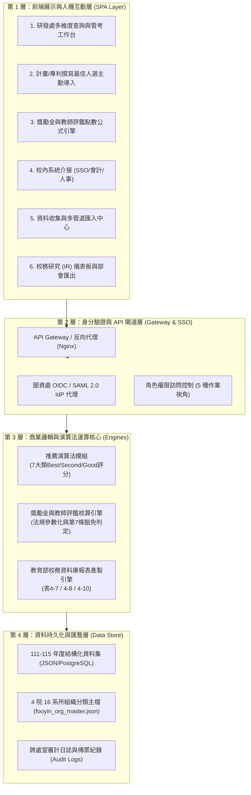

# 輔英科技大學教師歷年計畫案、論文、專利智慧收集與校務研究 (IR) 整合系統規格書

> **專案代號**：`FOOYIN-RD-IR-SYSTEM`  
> **制定版本**：Version 2.5 (正式核定版)  
> **發行日期**：2026 年 10 月  
> **主管單位**：研究與產學發展處 (Office of Research and Development)  
> **協辦單位**：圖書暨資訊處、會計室、人事室  
> **官方依據**：
> - [輔英科技大學學術單位組織編制 (4 院 16 系所)](https://www.fy.edu.tw/p/412-1032-8760.php?Lang=zh-tw)
> - [研究與產學發展處獎勵辦法與作業要點](https://etc.fy.edu.tw/p/412-1054-510.php?Lang=zh-tw)
> - [人事室《專任教師評鑑辦法》第七條 (兼行政主管免評規定)](https://epn.fy.edu.tw/p/412-1055-6611.php?Lang=zh-tw)
> - [會計室《執行計畫彈性支用額度作業要點》](https://eac.fy.edu.tw/p/412-1056-10422.php)
> - [教育部技專校院校務基本資料庫 (國立雲林科技大學維運平臺)](https://www.tvedb.yuntech.edu.tw/)

---

## 壹、專案背景與建置目標

輔英科技大學為南臺灣培育護理、醫事檢驗、生技環安及高齡長照專業人才之重點科技大學。面對教育部「高等教育深耕計畫」、技專校院校務評鑑、私校整體發展獎補助，以及教師多元升等之嚴格要求，研究與產學發展處（以下簡稱研發處）亟需一套整合型數位平台，以達成以下核心戰略目標：

1. **研發資產單一真理來源 (Single Source of Truth)**：
   破除跨處室資訊孤島，全面收攏 111–115 學年度全校專任教師之「國科會計畫、部會委辦計畫、教育部深耕/USR、企業產學、學術期刊論文 (SCI/SSCI/EI/TSSCI/Scopus) 及專利獲證與技術移轉」。
2. **AI 人才推薦與缺口診斷 (7 大類候選人演算法)**：
   建立「國科會專題、政府委辦、教育部深耕、企業產學、發明專利、新型專利、技術移轉」7 大類別「最佳／次佳／佳」人選推薦模型。系統能主動識別「已發表高 IF 論文但尚未申請專利」或「已有獲證專利但尚未簽訂技轉」之轉化缺口，主動推播一鍵確認單與專利事務所一對一服務。
3. **法規參數化自動試算引擎**：
   精準內建「研發績效獎勵金」與「人事室教師評鑑點數」試算公式，並落實《專任教師評鑑辦法》第七條——兼任行政主管教師得僅評教學基本指標之免評自動判定，同時整合會計室計畫管理費 8% 提撥 20% 彈性支用額度之試算。
4. **跨處室無縫介接與部會自動填報**：
   無縫整合圖資處 SSO 身分驗證、會計室經費代碼與傳票核銷、人事室評鑑回拋，並一鍵產製教育部技專校院校務基本資料庫表 4-7、4-8、4-10 標準格式 UTF-8 BOM CSV 清冊。

---

## 貳、組織架構主檔 (4 院 16 系所與研發處編制)

### 2.1 輔英科技大學 4 大學院與 16 系所編制

| 學院名稱 | 系所代碼 | 系所名稱 | 學制與學術重點 |
| :--- | :--- | :--- | :--- |
| **護理學院** (College of Nursing) | `NURS_01` | **護理系** | 日間碩士班、碩士在職專班、四技、二技、五專；智慧護理、臨床重症實踐 |
| | `NURS_02` | **助產與婦嬰健康照護系** | 碩士班、學士班；友善生產、母嬰生理監測、婦嬰健康輔具 |
| | `NURS_03` | **健康事業管理系** | 碩士班、碩士在職專班、學士班；醫療資訊系統、長照大數據、分級醫療 |
| | `NURS_04` | **高齡及長期照護事業系** | 碩士班、學士班；失智症照護、智慧穿戴復健、銀髮輔具開發 |
| **醫學與健康學院** (College of Medical and Health Sciences) | `MED_01` | **醫學檢驗生物技術系** | 碩士班、學士班；微流體生物晶片、分子診斷、病原體多重檢測 |
| | `MED_02` | **物理治療系** | 碩士班、學士班；關節角度感測、智慧穿戴復健、神經復健輔具 |
| | `MED_03` | **保健營養系** | 碩士班、碩士在職專班、學士班；機能性植化素、精準營養補充品、肌少症配方 |
| | `MED_04` | **健康美容系** | 學士班；植物外泌體、綠色化妝品配方、頭皮毛囊賦活 |
| **環境與生命學院** (College of Environment and Life Sciences) | `ENV_01` | **環境工程與科學系** | 碩士班、學士班；新興污染物降解、高級氧化程序、低碳生物膜、SROI |
| | `ENV_02` | **生物科技與綠色產業系** | 碩士班、學士班；微藻綠色超臨界萃取、低碳循環生技、機能性多醣體 |
| | `ENV_03` | **應用化學及材料科學系** | 碩士班、學士班；介孔碳奈米複合材料、重金屬吸附、綠色化學材料 |
| | `ENV_04` | **職業安全衛生系** | 碩士班、碩士在職專班、學士班；有害氣體智慧監測、半導體工安預警、ESG 風險 |
| **人文與管理學院** (College of Humanities and Management) | `HUM_01` | **幼兒保育暨產業系** | 學士班；老幼共融共學、幼兒情緒發展評估、托育科技輔具 |
| | `HUM_02` | **休閒與遊憩事業管理系** | 學士班；高齡森林療癒、健康療癒旅遊、銀髮體適能休閒、地方創生 |
| | `HUM_03` | **資訊科技與管理系** | 學士班；校務研究 (IR) 演算法、生成式 AI 決策系統、智慧醫護排班 |
| | `HUM_04` | **應用外語系** | 學士班；醫護專業英語 (ESP)、EMI 沉浸式雙語教材、醫療口筆譯 |

### 2.2 研發處內部任務編組
- **處本部 (HQ)**：統籌私校獎補助支用計畫、教育部校務基本資料庫填報、教師 6 年 6 個月產業研習管考。
- **產學合作組 (IAC)**：企業產學合作、政府部會委辦案、專利技術移轉與 70% 權利金分配計算。
- **研發創新組 (RDI)**：國科會專題計畫、學術期刊論文/專利獲證獎勵金審查、研發社群補助。

---

## 參、系統整體架構 (System Architecture)

系統採用現代化四層式微服務與單頁應用 (SPA) 混合架構：

---

## 肆、資料庫架構與資料字典 (Data Dictionary)

系統核心研發成果記錄主表（包含所有計畫案、論文、專利與技轉）：

| 欄位名稱 | 型態 | 必填 | 說明與範例 |
| :--- | :--- | :---: | :--- |
| `id` | VARCHAR(30) | 是 | 系統唯一流水號，如 `REC-115-001` |
| `year` | VARCHAR(3) | 是 | 民國學年度，範圍 `111` 至 `115` |
| `college` | VARCHAR(50) | 是 | 隸屬學院 (4 大學院之一) |
| `dept` | VARCHAR(50) | 是 | 隸屬系所 (16 系所之一) |
| `teacher` | VARCHAR(30) | 是 | 教師姓名，如 `賴文亮` |
| `empId` | VARCHAR(20) | 否 | 教職員工號，如 `ZH177` |
| `adminRole` | VARCHAR(100) | 否 | 行政職稱與評鑑辦法第7條備註 |
| `isArticle7Exempt`| BOOLEAN | 是 | 是否符合第7條主管免評研究標記 |
| `authorOrder` | VARCHAR(40) | 是 | 作者/主持序 (第一作者/計畫主持人/第二作者) |
| `weightRatio` | NUMERIC(3,2) | 是 | 作者折算係數 (1.0 / 0.5 / 0.25) |
| `category` | VARCHAR(20) | 是 | 成果大類：`計畫案`、`論文`、`專利` |
| `subType` | VARCHAR(50) | 是 | 細部類型 (如：國科會專題/SCI Q1/新型獲證等) |
| `title` | VARCHAR(500) | 是 | 計畫案名、論文篇名或專利名稱 |
| `code` | VARCHAR(100) | 是 | 計畫案號、DOI、專利證書號或申請號 |
| `accCode` | VARCHAR(100) | 否 | 會計管控代碼與核銷/撥付傳票號 |
| `disbursementRate`| INTEGER | 否 | 會計經費核銷率 (0 ~ 100%) |
| `amount` | NUMERIC(10,2) | 否 | 核定金額(計畫萬元)或實收技轉金額(萬元) |
| `ifScore` | NUMERIC(5,2) | 否 | 期刊影響係數 (JCR Impact Factor) |
| `metricNote` | VARCHAR(100) | 否 | 指標備註 (如：`IF: 8.4 (Q1)`) |
| `source` | VARCHAR(50) | 是 | 來源：`GRB/國科會`、`GPSS`、`DOI`、`Excel` |
| `group` | VARCHAR(30) | 是 | 研發處主政組別：`處本部`、`產學合作組`、`研發創新組` |
| `status` | VARCHAR(20) | 是 | 審核狀態：`已核定歸檔`、`待研發處審核`、`需教師補件` |
| `keywords` | ARRAY | 否 | 關鍵字陣列，供演算法進行主題媒合 |

---

## 伍、7 大類「最佳／次佳／佳」人選演算法公式

系統設定三級人選分類標準：
- **最佳人選（適配總分 ≥ 85 分）**：發送「第一波：種子優先導入」一鍵確認單，指派事務所一對一專人輔導。
- **次佳人選（適配總分 73–84 分）**：推動「第二波：跨域輔導導入」，媒合與最佳人選共同主持，推動高 IF 論文轉化專利。
- **佳人選（適配總分 60–72 分）**：推動「第三波：基盤擴散導入」，邀請參與研發社群與申請先期產學種子經費。

### 7 大類別加權計分邏輯摘要表

| 類別代碼 | 目標名稱 | 基礎分 | 核心表現加分 (+20~30) | 缺口診斷加分 (+20~26) | 系所優勢 (+6~9) |
| :--- | :--- | :---: | :--- | :--- | :--- |
| `proj_nstc` | 國科會專題計畫 | 62 | 國科會實績 (件×10) + SCI 篇數 | 承接先期產學或高 IF 論文 (+8) | 原創實驗室系所 |
| `proj_gov` | 政府部會委辦計畫 | 63 | 部會案實績 (件×12) + 經費量能 | 大型專案管理經驗 (+12) | 環工/職安/健管/護理 |
| `proj_moe` | 教育部深耕/USR/EMI | 64 | 教育部專案 (件×14) + 社區實證論文 | SROI 社會成效分析 (+15) | 護理/長照/幼保/休閒/外語 |
| `proj_iac` | 企業產學合作計畫 | 62 | 產學實績 (件×11) + 經費總量 | 具專利或技轉實績信任度 (+14) | 生技/職安/保營/健美/物治 |
| `pat_inv` | 發明專利撰寫申請 | 60 | 發明獲證實績 (件×12) | **【論文轉專利缺口】發 SCI 但未申專利 (+26)** | 醫檢/生技/應化/環工/健美 |
| `pat_util` | 新型/設計專利撰寫 | 62 | 新型專利實績 (件×11) | 執行中計畫具實體裝置可拆解 (+6) | 助產/物治/長照/職安/幼保 |
| `pat_tt` | 專利技術移轉授權 | 60 | 技轉經驗 (件×20 + 金額級距) | **【專利沉睡缺口】有專利但未技轉 (+22)** | 生技/物治/健美/醫檢/應化 |

---

## 陸、獎勵金與教師評鑑點數公式引擎

### 6.1 研發成果獎勵金 (研發處)
1. **期刊論文**：
   $$\text{實領獎金} = \text{期刊基準獎金} \times \text{作者折算率}$$
   - SCI/SSCI (Q1 或 IF≥5): NT$ 30,000
   - SCI/SSCI (一般): NT$ 20,000
   - EI / TSSCI / THCI 核心期刊: NT$ 12,000
   - Scopus 收錄期刊: NT$ 6,000
   - 折算率：第一作者/通訊作者 `100%`，第二作者 `50%`，第三作者起 `25%`。
2. **專利獲證**：
   - 發明專利 (獲證): NT$ 15,000；新型專利 (獲證): NT$ 5,000；設計專利: NT$ 5,000。
3. **技術移轉權利金分配**：
   $$\text{教師分配金額} = \text{實收技轉金額} \times 70\%$$
   $$\text{學校統籌留存} = \text{實收技轉金額} \times 30\%$$
4. **會計室彈性支用額度**：
   $$\text{彈性支用額度} = \min(50,000, \, \text{核定經費總額} \times 8\% \times 20\%)$$

### 6.2 專任教師評鑑點數 (人事室)
1. **《專任教師評鑑辦法》第七條免評機制**：
   教師人事檔註記「兼任行政主管」者，系統自動判定為**符合第 7 條規定**，得僅評「教學基本指標」，研究項目免評或自動認定達標。
2. **研究積分計分公式**：
   - 國科會專題計畫：$50 + \lfloor\frac{\text{金額(萬元)}}{50}\rfloor \times 10$ 點。
   - 政府委辦 / 企業產學 / 教育部深耕：$35 + \lfloor\frac{\text{金額(萬元)}}{50}\rfloor \times 10$ 點。
   - 校內先期計畫：$15$ 點。
   - 發明專利獲證：$35$ 點；新型/設計專利獲證：$15$ 點。
   - 專利技術移轉：$30 + \lfloor\frac{\text{實收技轉金(萬元)}}{10}\rfloor \times 8$ 點。

---

## 柒、跨處室介接規格 (SSO / 會計 / 部會)

1. **圖資處 SSO (Single Sign-On)**：
   - 支援 OpenID Connect 與 SAML 2.0，提供 `ZH177` (研發長)、`HQ001` (處本部)、`IAC001` (產學組)、`RDI001` (研創組)、`T2021` (系所教師) 5 大作業視角無縫切換。
2. **會計室 ERP 經費核銷**：
   - 介接 `ACC-xxx` 專案傳票，雙向校驗計畫核銷執行率，自動試算管理費與彈性額度，成果審核通過即時核發 `V-xxx` 撥付傳票。
3. **教育部校務基本資料庫 (TVEDB)**：
   - 產製表 4-7（專利與技轉）、表 4-8（學術論文）、表 4-10（產學合作與專案計畫）三份標準 UTF-8 BOM CSV，欄位代碼與格式完全相容教育部雲科大平臺。

---

## 捌、自動部署與維運規範 (GitHub Actions & GitHub Pages)

- **工作流程檔案**：`.github/workflows/deploy.yml`
- **觸發條件**：推送到 `main` / `master` 分支或手動 `workflow_dispatch`。
- **安全審驗**：部署前自動執行 Node.js 格式校驗、資料筆數檢查、7 大類人選演算法單元測試，確保上線零錯誤。
- **發布模式**：使用 GitHub 官方最新版 `actions/upload-pages-artifact@v3` 與 `actions/deploy-pages@v4`，零伺服器維護成本。
